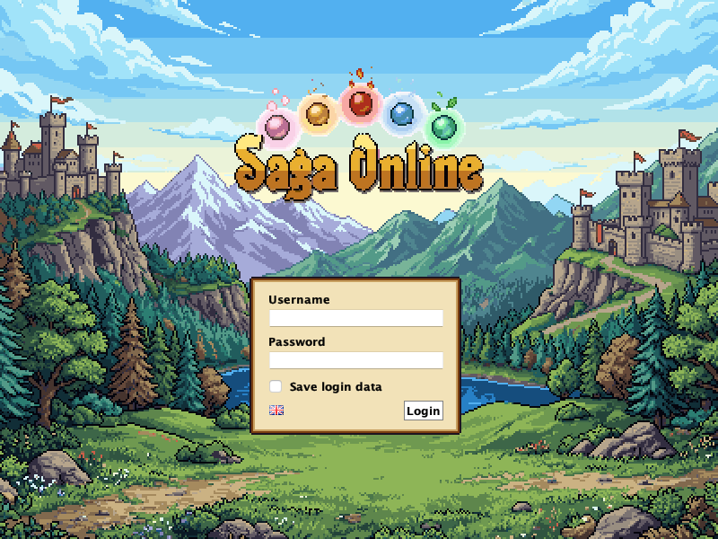
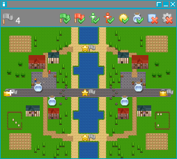
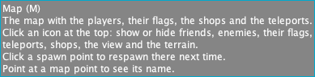
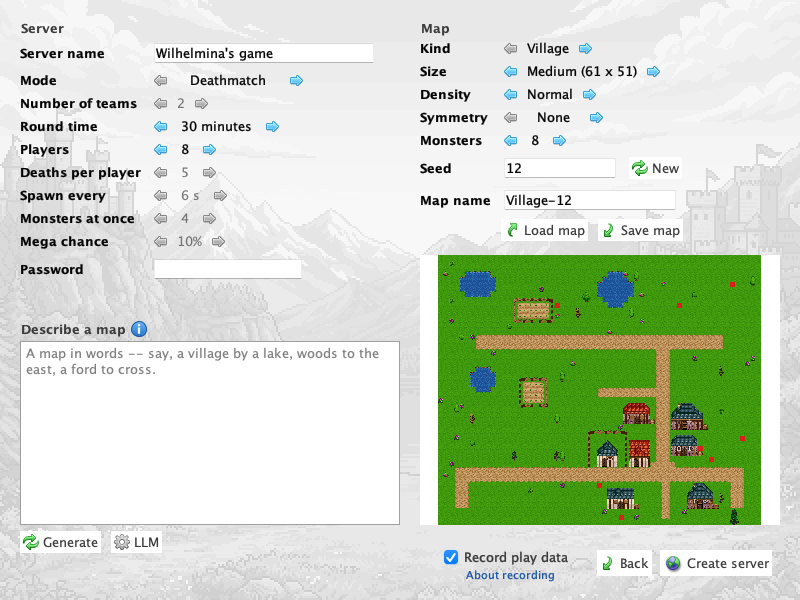
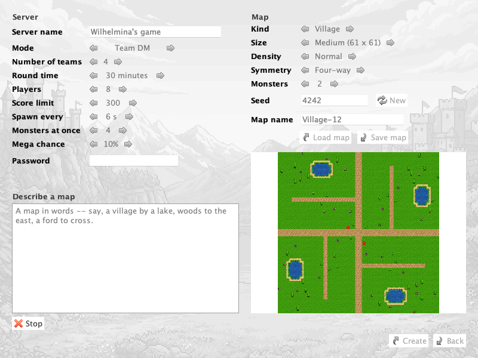
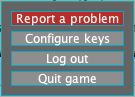

# Playing Saga Online

## Root server and game servers

The game talks to two kinds of server, which may run on different machines:

- **The root server** holds the accounts and logs you in, lists the game servers,
  offers the newest version of the game, and keeps the problem reports players send.
  Your copy of the game names one root server.
- **A game server** runs rounds, each with a map, a mode and the players in it. Any number of
  game servers register with a root server, on its machine or on others, and you can
  start your own from the game (**Create server** in the server list).

## What you need

- **Java 21 or newer.** On Windows and macOS, [Adoptium](https://adoptium.net) has
  installers ("Temurin 21"). If your computer has an older Java, the game says which it
  found and which it needs.
- **The game:** `saga-client.jar` from the [latest release](https://github.com/svalbrecht/saga-online-client/releases/latest).
  It is the whole game. Started, it unpacks its data into
  `~/.saga-online` in your home folder (`%USERPROFILE%\.saga-online` on Windows), and
  each time it starts it fetches a newer version from the root server if there is one.
- **An account** on the root server, from whoever runs it.
- **A network that reaches the root server and the game servers.**

## Starting

Double-click `saga-client.jar`, or run `java -jar saga-client.jar`. Log in, pick a
game server from the list and press Join.

The button under *Save login data* chooses the game's language. The game keeps your choice
for its next start. On Linux, Chinese, Japanese and Thai need a font that has their characters,
such as `fonts-noto-cjk` and `fonts-thai-tlwg`.

<p>
<a href="images/login.png"></a>
<a href="images/server-list.png"></a>
</p>

In the lobby, choose your character's look and type (and team, in a round with teams),
then press **Join** to enter the round.

<p>
<a href="images/lobby.png"></a>
<a href="images/round.png"></a>
</p>

Keys and windows are explained in the game. Every window's title bar has an **i** that
shows what the window does and how to use it.

In a round, **-** and **=** make the game's window smaller and larger; the game keeps the size for your next
round. **F12** shows the round on the whole screen, and back. The key window (**K**)
changes any key, to a single key or to a combination such as Cmd+Up or Shift+1.

<p>
<a href="images/window-map.png"></a>
<a href="images/window-map-info.png"></a>
</p>

## Playing against a trained bot

In a lobby, **Add bot** adds a bot of yours to the round, a character played by a trained
policy (a `.policy` file; see [the RL tutorial](https://github.com/ntu-agents/pysaga/blob/main/docs/rl-quickstart.md) to train one). The
game lists the policy files in `~/.saga-online/policies` with what each plays; one that
cannot play on this server is greyed, with the reason. In a round with teams, you choose
the bot's team. The bot plays under your account, named after you with `#1`, `#2` and so
on, and leaves when your game ends. On a server that lets in no bots, Add bot is greyed.

## Starting your own game server

Anybody can run a game server from the game, with **Create server** in the server
list. The game makes a map, starts the game server on your computer, registers it
with the root server you are logged in to, and joins it. Other players find it in
their server list and join it as they would any other.

<p>
<a href="images/create-server.png"></a>
<a href="images/create-describe.png"></a>
</p>

**The server** (left):

- **Server name**: how it appears in the server list.
- **Mode**: Deathmatch (everyone for themselves), Team Deathmatch, Domination
  (teams take and hold capture points), or Monster Attack (every player on one team,
  against monsters that come out of the map's monster homes and hunt the players).
  **Number of teams** applies to Team Deathmatch and Domination.
- **Round time**, **Players** (the most at once, up to 16), and **Score limit**: the
  points a team needs to win a Domination round, or the monsters it must kill in
  Monster Attack.
- **Spawn every**, **Monsters at once** and **Mega chance** (Monster Attack only): how
  often a monster spawns, how many may be up at once, and how many of them are Mega
  Monsters -- twice the size, three times the health, twice the strength, four times
  the reward. The map needs monster homes, which you choose under **Monsters**.
- **Password**: if set, players need it to join the game server.

**The map** (right). The game makes a new map from your choices.

- **Kind**: Village, Forest, Fields, Lakes, Arena or Lava.
- **Size**, **Density** (how many trees, houses and other obstacles) and **Symmetry**:
  a symmetric map gives every team the same ground. With no symmetry, one side may have
  an advantage.
- **Monsters**: how many monster homes the map has; every one is filled in the round.
- **Seed**: the same choices and seed always make the same map; **New** samples a new seed and regenerates the map from this seed.
- **Map name**, and **Load map** / **Save map** to use another map or keep this one.
  **Load map** lists every map you can host, each with its picture, size, teams, modes
  and monster homes, the maps that come with the game first and then your own. A map that
  comes with the game is played as it is. **From a file...** takes a map
  from anywhere.
  Save a map you want to keep with **Save map**. Your maps are kept in
  `~/.saga-online/player/maps`, one `.json` file each. A generated map is not kept on its
  own; its server has it while it runs.

The picture under the choices shows the map as it will be played.

**Describe a map** in words instead, and press **Generate**. A language model writes
the map, and the game checks it can be played before showing it. The first time, the
game asks for the model's provider and your API key, and keeps them on your computer
only. Generating takes a minute or more; **Stop** cancels it.

Press **Create** when you are happy with both. The game server runs as long as your
game does, and stops when you quit. Its log is in `~/.saga-online/logs/`, named
`server-<port>.log`.

- **Players on other computers** must reach yours, on the same network or connected
  over the same VPN. If they cannot join, your computer's firewall may be blocking
  Java; allow it when asked.
- **You are an admin** of the server you create. Kick a player with the red cross after
  their name in the lobby's player list, or kick or ban one from the menu a right click on
  them opens in a round. Other commands go in the chat, to change the map or restart the
  round, for example. Make other players an admin with `/addadmin <name>`. See
  [ADMIN_COMMANDS.md](ADMIN_COMMANDS.md).

## When the game cannot reach a server

If the game says *Could not connect to the server*, check that your computer reaches the
servers' machines at all, and send the output to whoever runs them. The commands below
need three things, put in place of the words in angle brackets.

- **`<root address>`** is the root server's address.
- **`<game address>`** is the game server's address, often the same machine.
- **`<file port>`** is the game server's port plus one, 40001 for a game server on
  port 40000. The game fetches the round's map over it.

The game's log in `~/.saga-online/logs/` names every server it tried, with its address
and port, for example *Game server at 192.168.0.6:40000 did not answer*. Whoever runs
the servers can tell you the addresses too.

On Windows, in PowerShell:

```powershell
ipconfig | findstr IPv4
ping -n 3 <root address>
Test-NetConnection <root address> -Port 50001
Test-NetConnection <game address> -Port <file port>
```

On macOS or Linux, in a terminal:

```
ping -c 3 <root address>
nc -vz -w 3 <root address> 50001
nc -vz -w 3 <game address> <file port>
```

- **Port 50001 does not answer:** your network does not reach the root server's machine,
  or a firewall filters the port. An address starting with 10., 172.16 to 172.31 or
  192.168. belongs to a private network, which you reach only from inside it or over its
  VPN. A machine may ignore the ping and still serve the game, so go by the port.
- **50001 answers, but the file port does not:** the root server is reachable and the
  game server is not. It is down, or its ports are filtered. Tell whoever runs the game
  server.

## Reporting a problem

If something goes wrong (a crash, a freeze, the game out of sync with other players,
something that looks wrong), report it from the game, straight after it happens:

- **In a round:** press Escape and choose **Report a problem**. Say what happened and
  what you were doing.

  <a href="images/escape-menu.png"></a>
- **In a lobby or a round:** type `/report` and a few words in the chat, for example
  `/report my character froze after the teleport`. The words go into the report, not
  to the other players.

A report carries:

- what you wrote;
- this game's log, and the log of the start before it, so a crash is still reported if
  you restart;
- what each part of the game was doing at that moment, which shows where a frozen game
  is stuck;
- a recording of the last ten minutes of the round, which replays your round step by
  step;
- your game settings (sound, keys, switches);
- the log of a game server you host from your machine;
- your computer's system, Java and display;
- your account name, and the game server, round and map.

A report reaches the people running the game, but there is no way to answer it. To
describe a problem, follow it up or suggest something, open an issue in
[the downloads repository's Issues](https://github.com/svalbrecht/saga-online-client/issues). If you
sent a report from the game, say roughly when, so the two can be matched. Problems with the
RL package (pysaga) belong in [its own Issues](https://github.com/ntu-agents/pysaga/issues).
