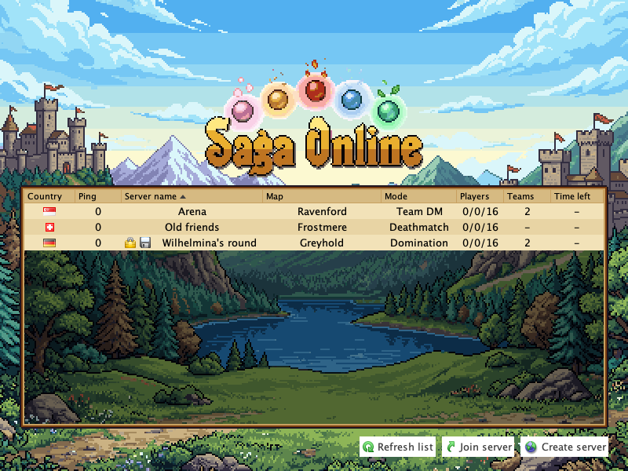
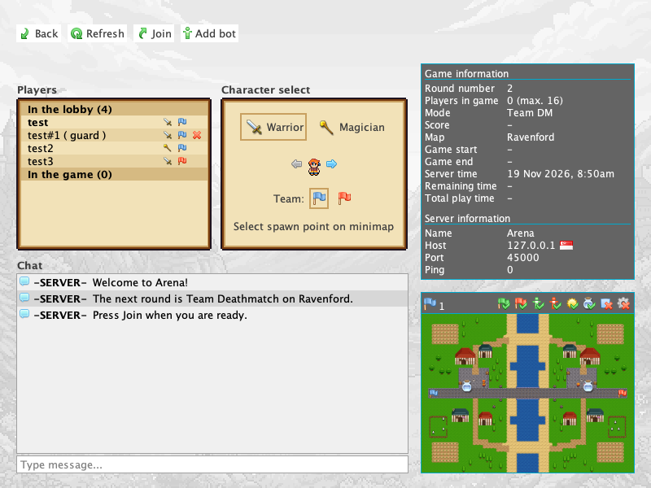
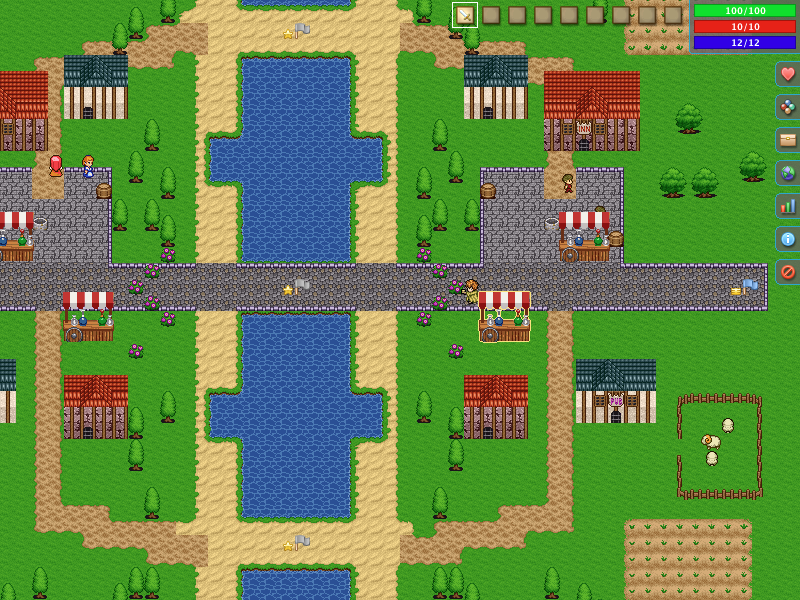

# Playing Saga Online

## Root server and game servers

The game talks to two kinds of server, which may run on different machines:

- **The root server** holds the accounts and logs you in, lists the game servers,
  offers the newest version of the game, and keeps the problem reports players send.
- **A game server** runs rounds, each with a map, a mode and the players in it. Any number of
  game servers register with a root server, on its machine or on others, and you can
  start your own from the game (**Create server** in the server list).

## What you need

- **Java 21 or newer.** On Windows and macOS, [Adoptium](https://adoptium.net) has
  installers ("Temurin 21"). If your computer has an older Java, the game says which it
  found and which it needs.
- **The game:** `saga-client.jar` from the [latest release](https://github.com/svalbrecht/saga-online-client/releases/latest).
  It unpacks its data into
  `~/.saga-online` in your home folder (`%USERPROFILE%\.saga-online` on Windows), and
  each time it starts it fetches a newer version from the root server if there is one.
- **An account** on the root server.
- **A network that reaches the root server and the game servers.**

## Starting

Double-click `saga-client.jar`, or run `java -jar saga-client.jar`. Log in, pick a
game server from the list and press Join.

**On a Mac, the first time:** macOS says the jar is from an unidentified developer and
will not open it. Open **System Settings → Privacy & Security**, scroll down to the
message about `saga-client.jar`, and click **Open Anyway**. Or run
`xattr -d com.apple.quarantine saga-client.jar` in Terminal, in the jar's folder. You only
need to do this once, since the game's own updates are not blocked.

<p>
<a href="images/login.png"></a>
<a href="images/server-list.png"></a>
</p>

In the lobby, choose your character's look and type (and team, in a round with teams),
then press **Join** to enter the round.

<p>
<a href="images/lobby.png"></a>
<a href="images/round.png"></a>
</p>

**Keys:** In a round, walk with the **WASD** keys, select abilities with the **1-9** keys and mouse scroll, and use a selected ability with the **E** key. With the mouse, click the ground to walk there, or click an enemy to attack it with the selected ability until it is gone; hold the button down to steer the walk, and a movement key cancels the click. Press **C** to see your current player stats, and press **F** to see the abilities you can learn. Chat with **G** (global chat - everyone in round) or with **T** (team chat - only team members). **Cmd+=** and **Cmd+-** (**Ctrl** on Windows and Linux) make the game window larger and smaller on every screen, **Cmd+0** returns it to normal size, **Cmd+Shift+P** (**Ctrl+Shift+P**) saves a screenshot on your desktop, and **F12** switches to full screen in a round. **Escape** opens a menu on every screen, to report a problem, configure keys, log out or quit. Press **K** to see all keys.

**Power and Focus:** A character's two stats. Power makes weapon strikes stronger, and Focus
makes abilities stronger. Deeper abilities need a minimum of both before they can be learned.
You raise them with the skill points you get as you level up, in the stats window (**C**).

Every window's title bar has an  (on left end) that shows what the window does and how to use it.


<p>
<a href="images/window-map.png"></a>
<a href="images/window-map-info.png"></a>
</p>

## Game modes

Every round runs until its time is up, unless its mode ends it sooner, and then its mode
names the winner. A server's admin may also set a score limit, which ends a round as soon
as a side reaches it. When the round ends, a window shows who won, the round's best
players and your own figures.

A character that dies comes back 6 seconds later at its spawn point, with full health.
You choose where you come back by clicking a spawn point on the lobby's map, or in a
round on the map window (**M**). In every mode, a kill scores the
level of the character killed, so a kill of a level 4 player scores 4.

| Mode | How it is played | Who wins |
| --- | --- | --- |
| **Deathmatch** | Every player plays for themselves. | The player with the most score. When scores are equal, the player with more kills wins, and then the one with fewer deaths. |
| **Team Deathmatch** | The players play in teams, 2 to 4 of them. | The team whose players together have the most score, with the same tie-breaks as in Deathmatch. |
| **Domination** | Teams fight for the map's capture points. A team takes a point when one of its players stands on it for 5 seconds while no player of another team is there. If two teams stand on a point, it does not change hands. Every point a team holds earns it one point a second. Capture points are shown only in this mode. | The team with the most points. |
| **Capture the Flag** | Each team's flag stands at its base. A player takes another team's flag by walking into it, and scores a capture by carrying it to their own base while their own flag is there. A player who dies, leaves or changes team drops the flag where they stand. A player of the flag's team returns it home by walking into it, and a dropped flag that nobody touches goes home after 15 seconds. | The team with the most captures when the time is up. |
| **Monster Attack** | Every player is on one team, against monsters that come out of the map's monster homes. Each monster hunts a player, preferring players that fewer monsters are hunting, and monsters come faster as the round goes on. Some are Mega Monsters, which are larger, more powerful, and give more experience points. Each monster killed scores a point for the team. | The team, if it survives until the time is up. It loses as soon as its deaths reach **Deaths per player** times the number of players, and the round then ends at once. |

## Adding bots

In a lobby, **Add bot** adds a bot of yours to the server. You choose the bot, its type and
look, and (where the bot allows) its team, its spawn point and whether it joins and leaves
the round with you or stays without you.

The game comes with built-in bots. The **Guard bot**, for example, stays near you and fights
the enemies that come near you. The window says what each bot does. You can also add trained
policies (`.policy` files; see [the RL tutorial](https://github.com/ntu-agents/pysaga/blob/main/docs/rl-quickstart.md)
to train one). The game lists the policy files in `~/.saga-online/policies` with what each
plays; one that cannot play on this server is greyed, with the reason.

A bot plays under your account, named after you with `#1`, `#2` and so on, and leaves when
your game ends. Remove one earlier with the red cross after its name in the lobby's player
list. In a Deathmatch, you and your bots never hurt each other. On a server that lets in no
bots, Add bot is greyed.

## Starting your own game server

Anybody can run a game server from the game, with **Create server** in the server
list. The game makes a map, starts the game server on your computer, registers it
with the root server you are logged in to, and joins it. Other players find it in
their server list and join it as they would any other.

<p>
<a href="images/create-server.png"></a>
</p>

**Server** (left):

- **Server name**: how it appears in the server list.
- **Mode**: one of the [game modes](#game-modes). **Number of teams** applies to Team
  Deathmatch, Domination and Capture the Flag.
- **Round time** and **Players**, the most players at once (up to 16).
- **Deaths per player**, **Spawn every**, **Monsters at once** and **Mega chance**: the
  settings of Monster Attack. Monster Attack also needs a map with monster homes, which you
  choose under **Monsters**.
- **Password**: if set, players need it to join the game server.

**Map** (right). The game makes a new map from your choices.

- **Kind**: the kind of landscape, such as a village, a forest or a lava world.
- **Size**, **Density** (how many trees, houses and other obstacles) and **Symmetry**.
  A symmetric map gives every team the same ground. With no symmetry, one side may have
  an advantage.
- **Monsters**: how many monster homes the map has; every one is filled in the round.
- **Seed**: the same choices and seed always make the same map; **New** samples a new seed and regenerates the map from this seed.
- **Map name**, and **Load map** / **Save map** to use another map or keep this one.
  **Load map** lists every map you can host, your own and those that come with the game,
  with what each one offers. A map that comes with the game is played as it is.
  **From a file...** takes a map from anywhere.
  Save a map you want to keep with **Save map**. Your maps are kept in
  `~/.saga-online/player/maps`, one `.json` file each. A generated map is not saved unless you save it; its server keeps it only while the server runs.

The picture under the choices shows the map as it will be played.

**Describe a map** in words instead, and press **Generate**. A language model writes
the map, and the game checks it can be played before showing it. The first time, the
game asks for the model's provider and your API key, and keeps them on your computer
only; **LLM** beside Generate changes them later. Generating takes a minute or more;
**Stop** cancels it.

**Record play data**, beside Create server, makes the server record its rounds for research.
Every player's moves and choices may be published, under a pseudonym and without chat, as
a dataset for training game-playing agents. Such a server is marked with a disk icon
in the server list, and every player, you included, is asked to agree before joining
it. The game remembers your choice for the next server you create. [Recorded play
data](recording.md) says what is recorded, why, where it is kept and whom to ask.

Press **Create server** when you are happy with both. The game server runs as long as your
game does, and stops when you quit. Its log is in `~/.saga-online/logs/`, named
`server-<port>.log`.

- **Players on other computers** must reach yours, on the same network or connected
  over the same VPN. If they cannot join, your computer's firewall may be blocking
  Java; allow it when asked.
- **You are an admin** of the server you create. Kick a player with the red cross after
  their name in the lobby's player list, or kick or ban one from the menu a right click on
  them opens in a round. Other commands go in the chat, to change the map or restart the
  round, for example. Make other players an admin with `/addadmin <name>`. See
  [ADMIN_COMMANDS.md](ADMIN_COMMANDS.md).

## When the game cannot reach a server

If the game says *Could not connect to the server*, check that your computer reaches the
servers' machines at all, and send the output to whoever runs them. The commands below
need three things, put in place of the words in angle brackets.

- **`<root address>`** is the root server's address.
- **`<game address>`** is the game server's address, often the same machine.
- **`<file port>`** is the game server's port plus one, 40001 for a game server on
  port 40000. The game fetches the round's map over it.

The game's log in `~/.saga-online/logs/` names every server it tried, with its address
and port, for example *Game server at 192.168.0.6:40000 did not answer*. Whoever runs
the servers can tell you the addresses too.

On Windows, in PowerShell:

```powershell
ipconfig | findstr IPv4
ping -n 3 <root address>
Test-NetConnection <root address> -Port 50001
Test-NetConnection <game address> -Port <file port>
```

On macOS or Linux, in a terminal:

```
ping -c 3 <root address>
nc -vz -w 3 <root address> 50001
nc -vz -w 3 <game address> <file port>
```

- **Port 50001 does not answer:** your network does not reach the root server's machine,
  or a firewall filters the port. An address starting with 10., 172.16 to 172.31 or
  192.168. belongs to a private network, which you reach only from inside it or over its
  VPN. A machine may ignore the ping and still serve the game, so go by the port.
- **50001 answers, but the file port does not:** the root server is reachable and the
  game server is not. It is down, or its ports are filtered. Tell whoever runs the game
  server.

## When the game stutters

Every player's game steps the round in lockstep. It waits for the other players' moves
for the next tick before it steps it, and a move has one tick (50 ms) to arrive. On a
slow link -- a VPN, or a Wi-Fi loaded by a video meeting on the same computer -- moves
arrive late and the game waits several times a minute, which feels like stutter. To give the moves more time, put a file `saga-client.properties` beside the jar holding the
line `inputdelay=2`, or `inputdelay=3` on a bad link. From a terminal,
`java -Dsaga.inputdelay=2 -jar saga-client.jar` does the same. The cost is that your own keys
take effect that many ticks later, 100 ms later at a delay of 2. The game notes in its log when the link is too slow for the setting,
which a problem report carries to the developers.

## Reporting a problem

If something goes wrong (a crash, a freeze, the game out of sync with other players,
something that looks wrong), report it from the game, straight after it happens:

- **On any screen:** press Escape and choose **Report a problem**. Say what happened and
  what you were doing.

  <a href="images/escape-menu.png"></a>
- **In a lobby or a round:** type `/report` and a few words in the chat, for example
  `/report my character froze after the teleport`. The words go into the report, not
  to the other players.

A report carries:

- what you wrote;
- this game's log, and the log of the start before it, so a crash is still reported if
  you restart;
- what each part of the game was doing at that moment, which shows where a frozen game
  is stuck;
- a recording of the last ten minutes of the round, which replays your round step by
  step;
- your game settings (sound, keys, switches);
- the log of a game server you host from your machine;
- your computer's system, Java and display;
- your account name, and the game server, round and map.

A report reaches the people running the game, but there is no way to answer it. To
describe a problem, follow it up or suggest something, open an issue in
[the downloads repository's Issues](https://github.com/svalbrecht/saga-online-client/issues). If you
sent a report from the game, say roughly when, so the two can be matched. Problems with the
RL package (pysaga) belong in [its own Issues](https://github.com/ntu-agents/pysaga/issues).
